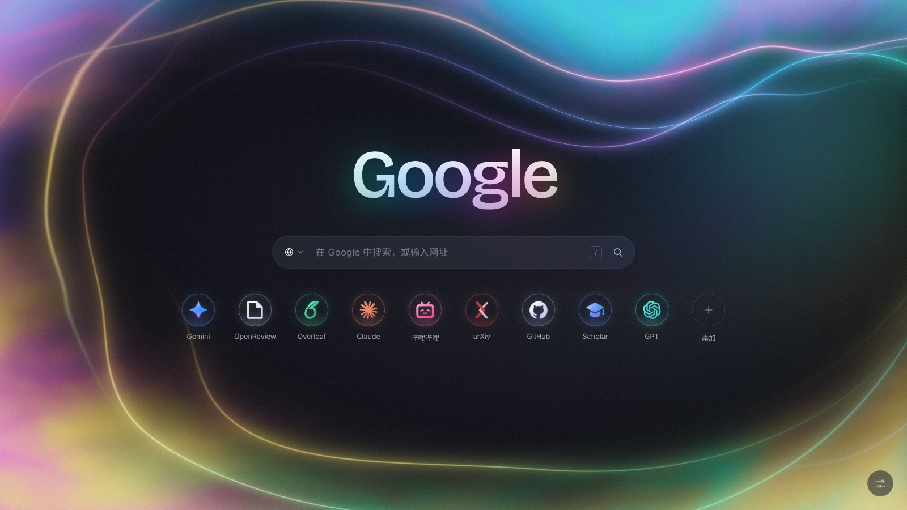
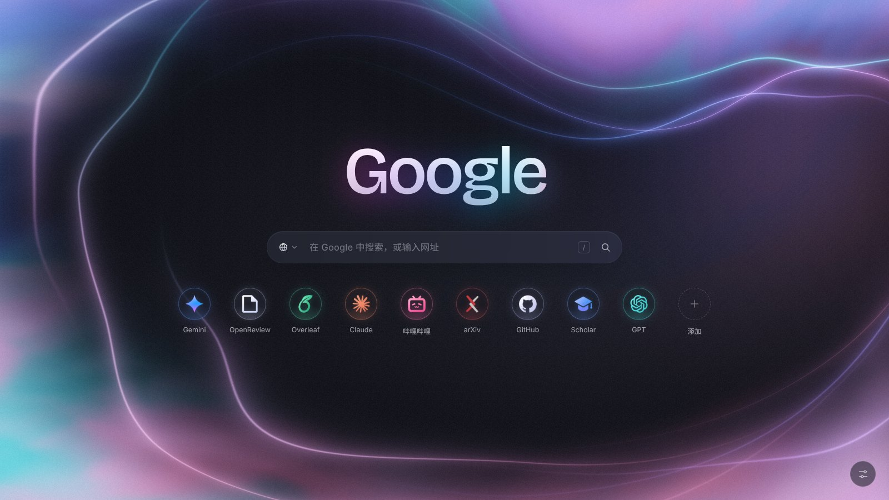
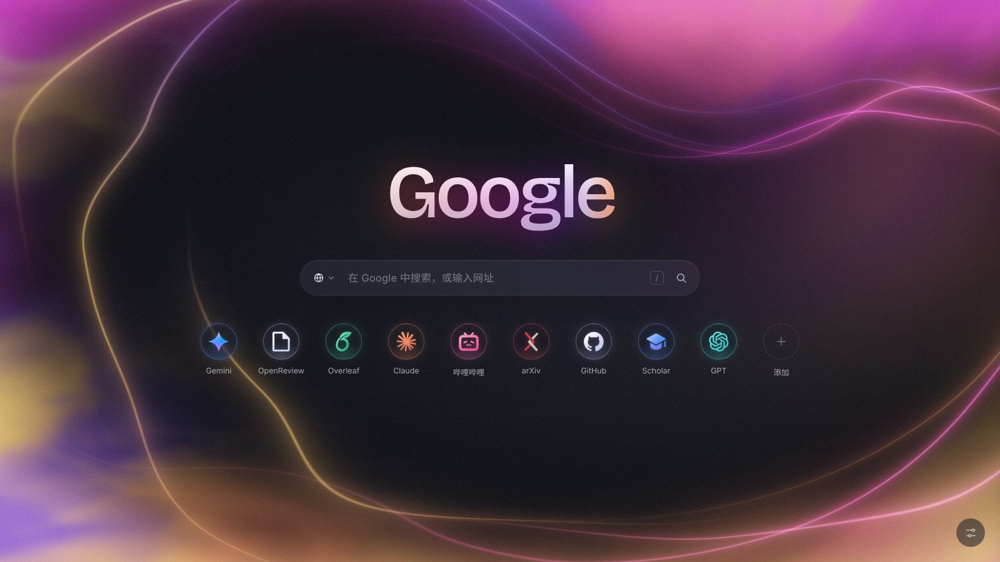
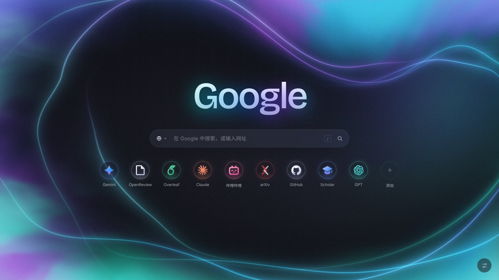
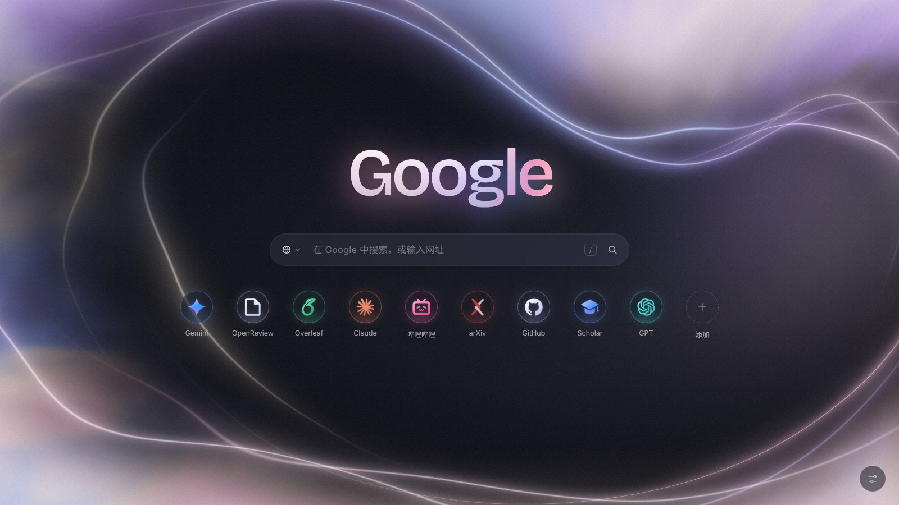
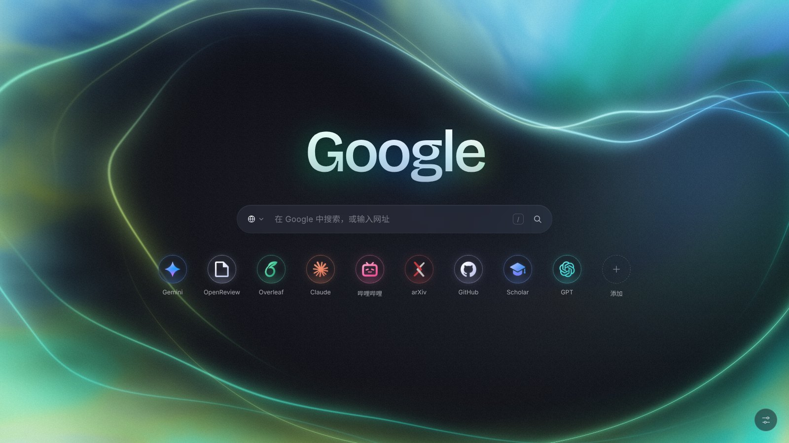
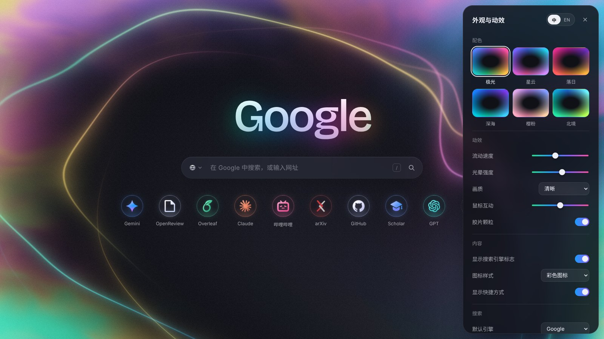
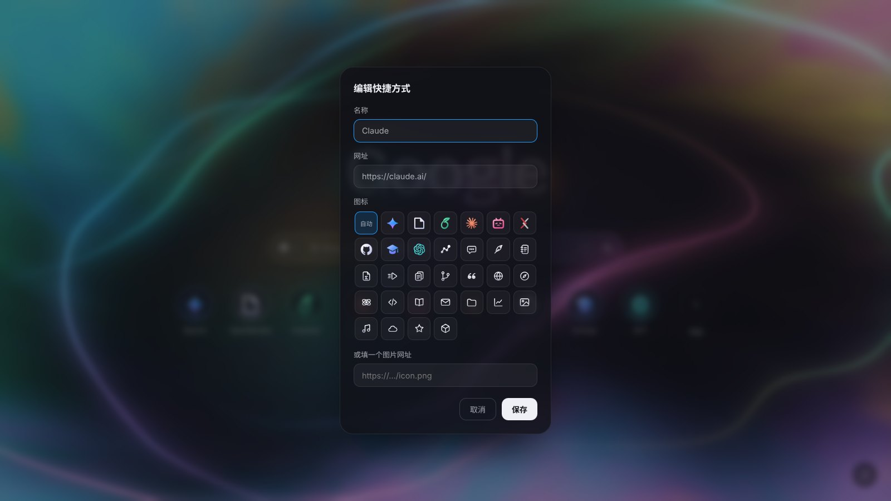
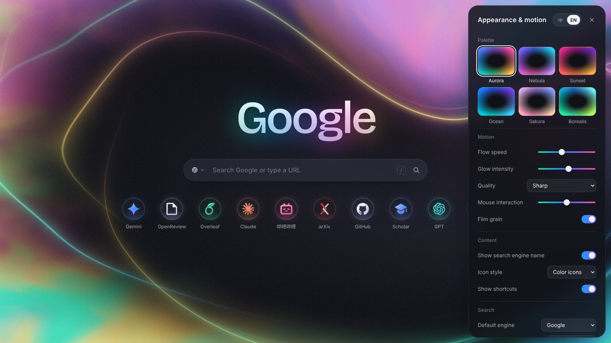

<div align="center">


# Halo Drift

</div>

<details open>
<summary><b>简体中文</b>（点击 English 切换英文）</summary>

<br>

一个 Chrome 新标签页扩展：屏幕四周是实时流动的 WebGL 极光，中间是带流光的搜索引擎标志、玻璃质感搜索框和彩色图标快捷方式。配套一个深色浏览器主题。



### 特性

- **实时流动的极光背景**：WebGL 着色器渲染，跟随屏幕刷新率；电脑跟不上时自动降低渲染分辨率保持流畅。
- **鼠标互动**：光带会被吸向鼠标，鼠标移动越快旋涡越明显，强弱可调。
- **六套配色**：在新标签页右下角的设置里随时切换，颜色平滑过渡。
- **搜索**：支持 Google、Bing、Google 学术和 arXiv，按 `Tab` 切换；上方标志跟着变成当前引擎的名字。输入网址直接回车会打开该网址。
- **快捷方式**：可拖动排序、编辑、删除。图标可以选彩色图标、22 个原创线条图标，或者填任意图片网址。
- **打开方式**：默认在新标签页打开，也可以改成新窗口或当前页。
- **中英文界面**：设置面板右上角一键切换。
- **设置同步**：通过 Chrome 账号同步到你的其他设备。

### 配色

| | | |
| :---: | :---: | :---: |
|  |  |  |
| **极光** · 绿、蓝、紫、粉、金五色轮转，默认配色 | **星云** · 粉紫和靛蓝为主，点缀青色 | **落日** · 橙红、玫红到深紫的暖色调 |
|  |  |  |
| **深海** · 青绿、湖蓝到靛紫的冷色调 | **樱粉** · 柔和的樱花粉、淡紫和杏色 | **北境** · 荧光绿、青和蓝，最接近真实的北极光 |

### 安装

1. 下载本仓库里的 `HaloDrift.zip` 并解压，把解压出来的 `HaloDrift` 文件夹放在一个不会被删掉的位置（Chrome 每次启动都会从这里读取）。
2. Chrome 地址栏打开 `chrome://extensions`，打开右上角的 **开发者模式**。
3. 把 `HaloDrift/extension` 文件夹拖进这个页面，或点「加载已解压的扩展程序」选择它。
4. 用同样的方式加载 `HaloDrift/theme` 文件夹（浏览器外框的深色主题，可选）。
5. 打开新标签页。如果 Chrome 询问是否保留对新标签页的更改，选 **保留**。

**更新**：用新版本的文件覆盖原来的文件夹，然后在 `chrome://extensions` 点扩展卡片上的刷新按钮。

### 使用

| 操作 | 方式 |
| --- | --- |
| 聚焦搜索框 | 按 `/` |
| 切换搜索引擎 | 在搜索框里按 `Tab` / `Shift+Tab`，或点左侧图标 |
| 打开设置 | 右下角按钮 |
| 切换界面语言 | 设置面板右上角「中 / EN」 |
| 编辑快捷方式 | 悬停后点左上角的铅笔 |
| 删除快捷方式 | 悬停后点右上角的 × |
| 调整顺序 | 直接拖动 |

<table>
<tr>
<td></td>
<td></td>
</tr>
<tr>
<td align="center">设置面板</td>
<td align="center">编辑快捷方式与图标选择</td>
</tr>
</table>

### 设置项

| 分组 | 设置 | 说明 |
| --- | --- | --- |
| 配色 | 六套配色 | 极光、星云、落日、深海、樱粉、北境 |
| 动效 | 流动速度、光晕强度 | 速度调到 0 背景静止 |
| | 画质 | 清晰 / 均衡 / 省电（30 帧，适合用电池时） |
| | 鼠标互动 | 调到最左关闭 |
| | 胶片颗粒 | 很淡的一层颗粒质感 |
| 内容 | 显示搜索引擎标志、显示快捷方式 | |
| | 图标样式 | 彩色图标 / 极光线条 |
| 搜索 | 默认引擎、打开网页 | 新标签页 / 新窗口 / 当前页 |

### 自定义

- **配色**：编辑 `extension/aurora.js` 顶部的 `PALETTES`，每套 5 个颜色。
- **搜索引擎**：编辑 `extension/app.js` 顶部的 `ENGINES`，`%s` 是搜索词的位置。
- **彩色图标**：把同名的透明背景正方形 PNG 放进 `extension/logos/` 覆盖；圆形底座的颜色在 `extension/glyphs.js` 的 `LOGOS` 里修改。
- 改完后在 `chrome://extensions` 点刷新。

### 常见问题

**打开新标签页后为什么光标在地址栏？** 这是 Chrome 的固定行为，扩展改不了。按 `/` 或点一下搜索框即可。

**能在新标签页里切换浏览器外框的颜色吗？** 不能。Chrome 不允许扩展随时修改浏览器外框，外框颜色只能由主题决定，所以 `theme` 做成了和六套配色都搭的中性深色。

**Chrome 提示「停用开发者模式扩展程序」？** 点关闭即可，不要点「停用」。

**为什么需要访问 Google 网站图标服务？** 只在你添加的网站图标选「自动」时使用：扩展从 `www.google.com/s2/favicons` 获取网站图标，并在本地处理成统一的样式。

### 项目结构

```
HaloDrift.zip        可直接安装的压缩包（extension + theme）
extension/           新标签页扩展源码
  aurora.js          WebGL 极光渲染
  app.js             搜索、快捷方式、设置
  glyphs.js          线条图标与彩色图标配置
  i18n.js            中英文文字
  logos/             彩色图标
theme/               Chrome 深色主题
screenshots/         README 截图
```

### 声明

- 代码使用 [MIT License](LICENSE)。
- 标志字体 Bricolage Grotesque 使用 SIL Open Font License，许可证见 `extension/fonts/OFL.txt`。
- `extension/logos/` 中的图标所代表的商标归各自所有者所有，本项目只把它们用作指向对应网站的快捷方式图标，与这些公司没有关联。

</details>

<details>
<summary><b>English</b></summary>

<br>

A Chrome new tab extension: a live WebGL aurora flows around the edges of the screen, framing a shimmering search engine wordmark, a glass search bar and color icon shortcuts. A matching dark browser theme is included.


### Features

- **Live aurora background**: rendered with a WebGL shader at your display's refresh rate. If your computer can't keep up, the render resolution drops automatically to stay smooth.
- **Mouse interaction**: light bands are drawn toward the cursor and swirl more when you move faster. Strength is adjustable.
- **Six palettes**: switch any time from the settings button in the bottom-right corner; colors blend smoothly.
- **Search**: Google, Bing, Google Scholar and arXiv. Press `Tab` to switch; the wordmark above changes with the engine. Typing a URL and pressing Enter opens it.
- **Shortcuts**: drag to reorder, edit or remove. Choose a color icon, one of 22 original line icons, or any image URL.
- **Open links in**: a new tab by default, or a new window or the current tab.
- **Chinese and English UI**: switch in the top-right corner of the settings panel.
- **Sync**: settings sync to your other devices through your Chrome account.

### Palettes

| | | |
| :---: | :---: | :---: |
|  |  |  |
| **Aurora** · green, blue, violet, pink and gold in rotation. The default | **Nebula** · pink-violet and indigo with touches of cyan | **Sunset** · warm orange-red and rose fading into deep purple |
|  |  |  |
| **Ocean** · cool teal and lake blue into indigo | **Sakura** · soft cherry-blossom pink, lilac and apricot | **Borealis** · vivid green, cyan and blue, closest to real northern lights |

### Install

1. Download `HaloDrift.zip` from this repository and unzip it. Keep the `HaloDrift` folder somewhere permanent, because Chrome loads it from there on every start.
2. Open `chrome://extensions` and turn on **Developer mode** in the top-right corner.
3. Drag the `HaloDrift/extension` folder onto the page, or click **Load unpacked** and select it.
4. Load the `HaloDrift/theme` folder the same way (optional dark browser theme).
5. Open a new tab. If Chrome asks whether to keep the new tab page change, choose **Keep it**.

**Updating**: replace the folder with the new version, then click the reload button on the extension card in `chrome://extensions`.

### Usage

| Action | How |
| --- | --- |
| Focus the search bar | Press `/` |
| Switch search engine | `Tab` / `Shift+Tab` in the search bar, or click the icon on the left |
| Open settings | Button in the bottom-right corner |
| Change UI language | "中 / EN" in the top-right corner of the settings panel |
| Edit a shortcut | Hover, then click the pencil (top-left) |
| Remove a shortcut | Hover, then click × (top-right) |
| Reorder | Drag |

<table>
<tr>
<td></td>
<td></td>
</tr>
<tr>
<td align="center">Settings panel</td>
<td align="center">Editing a shortcut and choosing an icon</td>
</tr>
</table>

### Settings

| Group | Setting | Notes |
| --- | --- | --- |
| Palette | Six palettes | Aurora, Nebula, Sunset, Ocean, Sakura, Borealis |
| Motion | Flow speed, Glow intensity | Speed 0 stops the background |
| | Quality | Sharp / Balanced / Power saver (30 fps, good on battery) |
| | Mouse interaction | Slide fully left to turn off |
| | Film grain | A faint grain texture |
| Content | Show search engine name, Show shortcuts | |
| | Icon style | Color icons / Aurora lines |
| Search | Default engine, Open links in | New tab / New window / Current tab |

### Customize

- **Palettes**: edit `PALETTES` at the top of `extension/aurora.js`. Each palette has 5 colors.
- **Search engines**: edit `ENGINES` at the top of `extension/app.js`. `%s` marks where the query goes.
- **Color icons**: overwrite the PNGs in `extension/logos/` with square, transparent images of the same name. The ring tint for each icon is set in `LOGOS` in `extension/glyphs.js`.
- After editing, click reload in `chrome://extensions`.

### FAQ

**Why is the cursor in the address bar when I open a new tab?** Chrome always does this and extensions can't change it. Press `/` or click the search bar.

**Can the new tab page change the browser frame color?** No. Chrome doesn't let extensions change the browser frame on the fly; only a theme can. That's why `theme` is a neutral dark design that suits all six palettes.

**Chrome shows "Disable developer mode extensions"?** Close the prompt. Don't click Disable.

**Why does it need access to Google's favicon service?** Only when you set a shortcut's icon to "Auto": the extension fetches the site icon from `www.google.com/s2/favicons` and restyles it locally.

### Project layout

```
HaloDrift.zip        Ready-to-install package (extension + theme)
extension/           New tab extension source
  aurora.js          WebGL aurora renderer
  app.js             Search, shortcuts, settings
  glyphs.js          Line icons and color icon config
  i18n.js            Chinese and English strings
  logos/             Color icons
theme/               Dark Chrome theme
screenshots/         README screenshots
```

### Notices

- Code is released under the [MIT License](LICENSE).
- The wordmark font, Bricolage Grotesque, is under the SIL Open Font License; see `extension/fonts/OFL.txt`.
- The trademarks shown by the icons in `extension/logos/` belong to their respective owners. This project uses them only as shortcut icons linking to those sites and is not affiliated with those companies.

</details>
